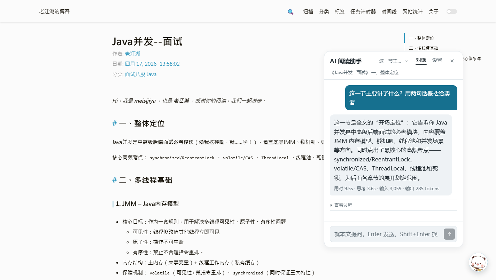
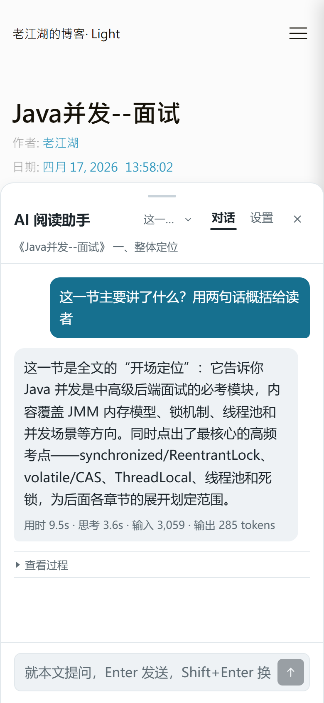

# blog-ai-assistant

博客站点的 **AI 阅读助手**：悬浮在文章页面上的对话助手，读者自带大模型 Provider 与访问凭据，浏览器直连调用。

博客本身是纯静态站点（Hexo + Chic 主题 + GitHub Pages），**不持有、不转发任何模型凭据**。密钥只存在读者这台浏览器的 `localStorage` 里，请求由浏览器直接发往读者自己填写的 Provider 端点。

本仓库是主站仓库 [`meisijiya/Blog`](https://github.com/meisijiya/Blog) 的子模块（`source/ai-assistant/`），独立版本化，便于单独迭代。

---

## 界面

宽屏：贴球浮窗，浮球可拖拽。



窄屏：底部抽屉，顶部的抓手可以拖动改变高度。



## 它能做什么

- **按小节问答**：自动带上读者当前所在小节的正文，回答里标注出自哪篇哪一节。
- **站内检索**：先出文章标题目录，再按标题逐级下钻读取正文，而不是一次性灌整篇。
- **划词提问**：选中正文里的句子可以直接追问。
- **多会话**：会话列表在本地保存，可重命名、删除；回答进行中不会被切走。
- **过程可见**：思考过程与工具调用默认收起成「查看过程」，展开能看到读了哪几段正文、命中多少条。

## 怎么用

1. 打开博客任意文章页，点右下角悬浮球打开助手。
2. 切到「设置」页，填三项：
   - **协议**：OpenAI 兼容 或 Anthropic Messages
   - **Base URL**：你的 Provider 端点，例如 `https://api.minimax.cn/v1`
   - **API Key** 与 **模型名**
3. 点「保存配置」，回到「对话」页提问。

保存按钮旁的提示写得很直白：**密钥与配置只存在这台浏览器**。

### 凭据去了哪里

| 去向 | 说明 |
|---|---|
| `localStorage['ai-assistant.config']` | 唯一持久化位置，含 Base URL、密钥、模型名、提示词 |
| Provider 请求头 | 密钥只出现在发往读者自填端点的 `Authorization`（或 Anthropic 的 `x-api-key`）头里 |
| 错误提示 | Provider 回显的密钥在界面里会被脱敏成 `***` |

站内请求（检索索引、跨文章取正文）**不带任何鉴权头**，请求体里也不含密钥。

## 代码结构

全部是 classic script（IIFE 包裹，挂 `window.AIAssistant`），零 npm 依赖，不引外部 CDN。

| 文件 | 行数 | 职责 |
|---|---:|---|
| `ai-assistant-main.js` | 1629 | 主流程：配置、预设、上下文装配、工具轮次、会话与 provider 历史接线 |
| `ai-assistant-ui.js` | 2173 | 面板 DOM 与渲染（自写 Markdown 渲染，不引第三方库） |
| `ai-assistant-provider.js` | 857 | Provider 适配：两种协议、SSE 解析、错误分型、密钥脱敏、usage 汇总 |
| `ai-assistant-context.js` | 306 | 小节切分与当前阅读位置识别（读标题 id，不做数据副本） |
| `ai-assistant-tools.js` | 304 | 三个工具：`list_articles` / `search_articles` / `read_section` |
| `ai-assistant-search.js` | 251 | 分层检索：本地 BM25 → 模型改写 → 模型重排 |
| `ai-assistant.css` | 1846 | 界面样式 |
| `ai-assistant-tokens.css` | 101 | 设计令牌（跟随 `body.dark-theme` 翻面） |

样式令牌只写在 `ai-assistant-tokens.css` 一处，`ai-assistant.css` 只消费变量。

## 接入主站

主站把本目录当普通静态资源原样拷贝，索引与注入由主站构建期脚本完成：

- `scripts/ai-assistant-index.js`：派生 `ai-assistant/index.json` 轻量检索索引（标题 / 摘要 / 小节标题 / 关键词，无正文）。
- `scripts/ai-assistant-inject.js`：`after_render:html` 钩子，给整页注入助手资源。

子模块目录里多出的 `README.md` 与 `docs/` 截图目录，主站用 `_config.yml` 的 `exclude` 挡在 `public/` 之外。

## 验证

行为门禁在主站仓库里，跑主站的冒烟与真实浏览器回归即可覆盖本模块：

```bash
node tools/ai-assistant-smoke.js   # jsdom：协议适配、检索召回、渲染结构、会话、密钥本地化
node tools/ai-assistant-cdp.js      # 真实 Chrome：拖拽、抽屉、划词、排版、请求头抓取
```

其中「密钥只落本地、不外传」这一条有专门的机械断言：smoke 的 U 组（配置只落 localStorage、站内请求无鉴权头、密钥只在 Provider 请求头、错误回显已脱敏、页面无明文密钥）与 CDP 的 S 组（真实浏览器抓 `Network.requestWillBeSent`，确认密钥只出现在发往 Provider 的那一条请求上）。

## 已知限制

- 只在博客自身的文章页有意义：非文章页没有上下文，助手会退化成纯问答。
- 检索索引在构建期生成，发布新文章后才会有新内容可查。
- Provider 侧的缓存保存多久由 **Provider 自己** 的 retention policy 决定，与本站的本地历史无关；本地历史只会在读者主动删除或超出上限（30 个会话 / 200 条消息）时消失。
